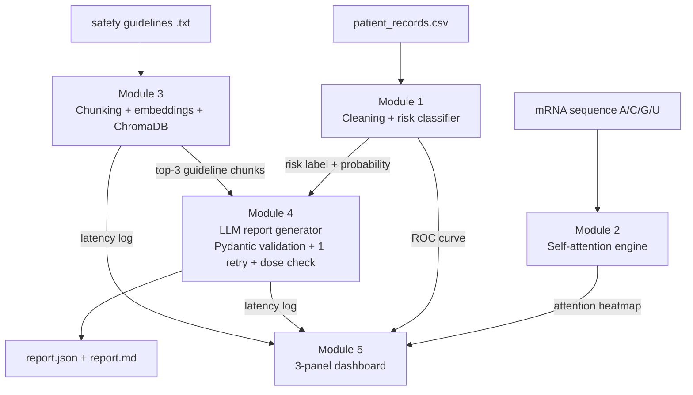
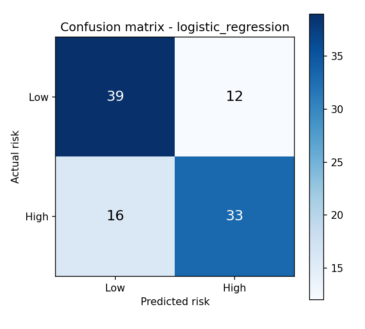
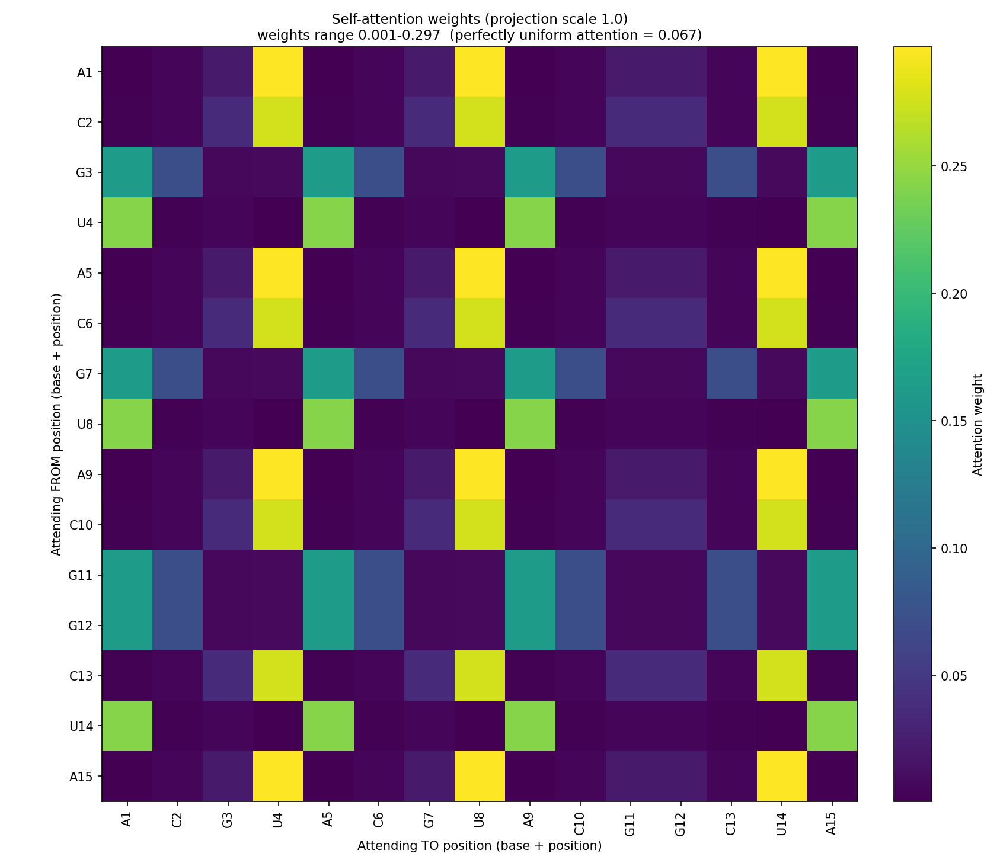
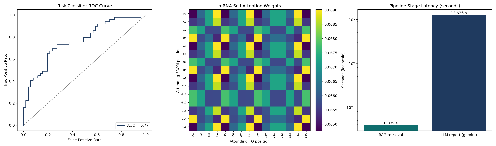

# mRNA-VIP: Vaccine Clinical Safety & Dosage Intelligence Pipeline

**Portfolio Report** · Palak Gupta · Repository: github.com/palakg242-dotcom/mrna-vip

> Student engineering project. Nothing in this report or in the generated outputs is real clinical guidance.

---

## 1. Executive Summary

mRNA-VIP is a four-stage AI pipeline built as an individual learning project around a Moderna-style case study. A classical machine-learning model predicts whether a patient is at low or high risk of a vaccine reaction. A self-attention engine written from scratch in NumPy shows how a Transformer weighs the bases of an mRNA sequence. A retrieval index (ChromaDB) finds the relevant passages in a safety guideline document. Finally, an LLM combines the risk score and the retrieved passages into a structured, schema-validated safety report that always carries a disclaimer and cites the guideline text it relied on.

The project demonstrates end-to-end ML engineering: data cleaning without leakage, model comparison, a from-scratch deep-learning building block, retrieval-augmented generation, structured LLM output with validation, and honest measurement of latency and failure cases. Every module is covered by tests, and the repository has a step-by-step commit history.

## 2. Architecture



Each module writes its output to `outputs/`, and the next module reads it. The report generator is the only stage that depends on three others (risk model, retrieval, and an LLM).

## 3. Module 1 Results: Risk Classifier

**Data.** 500 patients with age, biomarker level, vaccine dose (mcg), prior reaction history, and number of pre-existing conditions. Biomarker level had 20 missing values (4%), and 17 cells of prior reaction history were truly empty.

**Two decisions that changed the results.** First, 291 rows contain the text `"None"` in prior reaction history (meaning *no previous reaction*). Pandas reads this as missing, so the PRD template's mode imputation would have turned them into "Mild". I read the file with `keep_default_na=False`, so only the 17 genuinely empty cells were imputed. Second, the template fits the scaler before the train/test split, which leaks test information into training. I fit the scaler on the training set only. I also encoded prior reactions in their natural order (None < Mild < Moderate) instead of alphabetically.

| Model | Accuracy (test) | High-risk F1 | 5-fold CV mean F1 |
|---|---|---|---|
| **Logistic Regression** (selected) | 0.72 | 0.70 | 0.72 |
| Random Forest | 0.65 | 0.64 | 0.64 |



**Interpretation.** Logistic Regression beat Random Forest on the test set and in cross-validation, so the gap is not an accident of one split. With only 500 patients and five features, the simpler model generalises better, while the Random Forest probably fits noise. The saved model reaches an ROC AUC of 0.77, which is useful but far from clinical-grade; it is good enough to feed a downstream demo. The confusion matrix shows where the errors are: of the 100 held-out patients, the model correctly flagged 33 of the 49 truly high-risk patients (recall 0.67) and missed 16, while 39 of 51 low-risk patients were classified correctly. In a safety setting the 16 missed high-risk patients matter most, so a real system would lower the decision threshold to trade some precision for higher recall.

## 4. Module 2 Results: Self-Attention From Scratch

I implemented scaled dot-product attention in NumPy for a 15-base mRNA sequence (embedding size 8): each base gets a query (Q), key (K), and value (V); scores are `QKᵀ / √8`; a softmax turns each row into weights that sum to 1; and the output is the weighted mix of the values. A 3-token example solved by hand (0.802, 0.599) matches the code output exactly. I also added multi-head attention as a bonus (3 heads, output shape 15 × 24).



**What the heatmap shows.** Each row is a base asking "who should I look at?", and each column is a base being looked at. With the PRD's small starting weights (×0.1), every cell is between 0.065 and 0.069, almost exactly the uniform value 1/15 = 0.067: the model pays equal attention to everything. With larger weights (×1.0) a pattern appears: A and C bases attend most strongly to U (about 0.3). This preference comes from random initialisation, not from biology. The heatmap illustrates the mechanism; it is not a trained model and says nothing real about mRNA.

## 5. Module 3 Results: Retrieval (RAG)

The guideline document is short (about 750 words), so a sentence-aware chunker that counts tokens (not characters, as the template does) produced **3 chunks of 427, 414 and 348 tokens** with a 50-token overlap. Embeddings come from `all-MiniLM-L6-v2` and are stored in ChromaDB; each query returns the top 3 chunks.

| # | Question | Top-1 chunk | Similarity | Keyword in top-3 | Latency |
|---|---|---|---|---|---|
| 1 | Storage temperature of unopened vials | 0 | 0.76 | yes, rank 1 | 0.010 s |
| 2 | Can a thawed vial be refrozen? | 0 | 0.48 | yes, rank 1 | 0.010 s |
| 3 | Which dose needs secondary clinician review? | 1 | 0.53 | yes, rank 1 | 0.009 s |
| 4 | Patient aged 65+ with pre-existing conditions | 2 | 0.32 | yes, rank 2 | 0.010 s |
| 5 | Time limit for documenting a moderate adverse event | 2 | 0.51 | yes, rank 1 | 0.009 s |
| 6 | Monitoring time after injection | 2 | 0.50 | yes, rank 1 | 0.009 s |
| 7 | Safe during pregnancy? (**not in the document**) | 1 | 0.31 | n/a (out of scope) | 0.008 s |

Mean latency was 0.009 s, far below the 5 s requirement.

**Retrieval quality.** On the six in-scope questions the relevant keyword appeared in the top-3 results every time, and in rank 1 for five of them. Question 4 is the weakest (similarity 0.32, relevant text only at rank 2). Two caveats: this keyword check is automatic and only a hint, and with just 3 chunks in the index a top-3 query returns the whole document, so "recall@3" is trivially perfect and not a meaningful score. The out-of-scope pregnancy question is the clearest failure case: the system returned the dosing chunk with similarity 0.31 instead of saying "no answer". Retrieval always returns the nearest chunk; it never abstains.

## 6. Module 4 Results: Structured LLM Report

The generator builds a prompt from the patient summary, the Module 1 risk output, and the Module 3 chunks. The system prompt carries the four required safety rules (do not contradict the guideline, do not invent facts, default to "not eligible" when information is insufficient, always include the disclaimer). The reply must parse into a Pydantic `ClinicalSafetyReport`; if it fails, exactly one retry is made. Two changes from the PRD template: I call the Gemini SDK directly (free tier) instead of LangChain + OpenAI, and the dose is validated in **mcg**, because the data and guidelines use mcg while the template schema said mg (100 mcg = 0.1 mg). The 100 mcg limit is enforced in code, not left to the LLM.

**Sample output, patient P001** (58 years old, 2 pre-existing conditions, no prior reaction, biomarker 6.5, candidate dose 120 mcg; generated by `gemini-3.5-flash-lite`, saved in `outputs/reports/report_P001_gemini.json`):

```json
{
  "Eligible_For_Vaccine": false,
  "Recommended_Dose_mg": 0.0,
  "Reasoning_Steps": [
    "The patient is 58 years old with 2 pre-existing conditions and a candidate dose of 120 mcg (0.12 mg).",
    "Section 2.1 states that doses above 100 micrograms are considered high-reactogenicity doses and require secondary clinician review before administration.",
    "Section 3.2 states that a candidate dose exceeding 100 micrograms combined with an elevated biomarker level requires precautions requiring secondary review.",
    "Because the retrieved excerpts do not contain enough information to safely clear this high-reactogenicity dose and elevated biomarker combination without secondary review, eligibility is set to false according to conservative rules.",
    "Recommended dose is set to 0 mg and reasoning is explained."
  ],
  "FDA_Safety_Warnings_Cited": [
    "Doses above 100 micrograms are considered high-reactogenicity doses and require secondary clinician review before administration.",
    "Candidate dose exceeding 100 micrograms combined with an elevated biomarker level."
  ],
  "Disclaimer": "Student engineering project output - not real clinical guidance."
}
```

**How it is grounded.**

| Field | Where it comes from |
|---|---|
| Risk context (High risk, probability 0.79, shown in the Markdown version of the report) | Module 1 classifier |
| `FDA_Safety_Warnings_Cited` | Text taken from the chunks retrieved by Module 3 (the first citation is a full guideline sentence, the second a short fragment) |
| `Eligible_For_Vaccine = false`, dose 0 | 120 mcg is above the 100 mcg guideline limit; the limit is also enforced by the code-level dose check, not only by the LLM |
| Reasoning steps 2-3 | Section 2.1 (dose limit) and Section 3.2 (high dose + elevated biomarker) of the retrieved guidelines |
| Reasoning step 4 | The conservative default required by safety rule 3 when the excerpts cannot clear the patient |
| `Disclaimer` | Schema default; present in every report and in the Markdown header and footer |

One weakness is visible here. The guideline gives no number for an "elevated" biomarker, yet this report treats a level of 6.5 as elevated without saying so. The earlier `gemini-3.8-flash` run of the same patient stated openly that the normal range was missing. This shows that the safety rules reduce, but do not remove, unsupported assumptions by the LLM (see Limitations).

All five sample patients produced a valid report (JSON + Markdown pair each) with the disclaimer present.

**LLM latency and the model switch.** The first model I used (`gemini-3.8-flash`) took 77.5 s for P001 and then returned a `503 UNAVAILABLE` ("high demand") on the next run. I switched to `gemini-3.5-flash-lite`, which answered P001 in 1.6 s and P005 in 12.5 s. This is free-tier behaviour: latency depends on server load, not only on my code. The first P001 report was written by the older model; the five final reports come from the lite model. A mock provider (no API key, clearly labelled in the report) lets all tests run offline.

## 7. Dashboard



Panel A is the ROC curve of the risk classifier (AUC 0.77). Panel B is the attention heatmap from Module 2. Panel C compares pipeline latency: retrieval takes a few hundredths of a second, while LLM report generation takes seconds (the bar shows the most recent logged run, about 12.6 s). The image is saved at 150 DPI.

## 8. Limitations & Future Work

1. **Tiny knowledge base.** The guidelines produce only 3 chunks, so retrieval metrics are not meaningful, and top-3 returns nearly the whole document. *With more time:* index a larger, real label corpus, evaluate recall@k on a hand-labelled question set, and use hybrid (keyword + embedding) search.
2. **Retrieval never says "I don't know".** The pregnancy question returned an unrelated chunk (similarity 0.31). A simple similarity threshold would not fix this, because the in-scope 65+ question scored 0.32 and the out-of-scope pregnancy question 0.31. *Fix:* tell the LLM to answer only from the retrieved text and to say "not covered" when the excerpts lack the answer (the Week 4 default to "not eligible" partly does this), and evaluate abstention on a larger question set.
3. **"Elevated biomarker" is undefined.** The guideline says "meaningfully above normal" without a number, so the LLM cannot decide: one model run flagged the gap, while the final P001 report assumed the level was elevated without saying so. *Fix:* obtain the reference range from a clinician or source document and add it to the knowledge base, then re-test.
4. **Small data, modest model.** 500 patients, five features, AUC 0.77. *Fix:* more data, calibration of probabilities, and tuning with cross-validation; compare against gradient boosting.
5. **LLM cost, latency and reliability.** Free-tier latency varied from 1.6 s to 77 s and one call failed with a 503. *Fix:* add exponential backoff, cache repeated prompts, and measure latency over many runs (not one patient) before drawing conclusions.
6. **Disconnected attention module.** The attention engine uses random weights and does not feed the risk model. *Fix:* train it, or use real sequence embeddings, and connect it to a downstream task.
7. **Reproducibility details.** The saved model triggers a scikit-learn version warning when loaded in another version. *Fix:* pin versions and regenerate the model in the target environment.

## 9. Reproduction Instructions

Tested on Windows 11 with Python 3.12. Commands are for PowerShell; on macOS/Linux use `source .venv/bin/activate`.

```bash
# 1. Get the code
git clone https://github.com/palakg242-dotcom/mrna-vip.git
cd mrna-vip

# 2. Create an environment and install dependencies
python -m venv .venv
.venv\Scripts\activate
pip install -r requirements.txt

# 3. (Only for the real LLM) copy .env.example to .env and fill in:
#    LLM_PROVIDER=gemini
#    GEMINI_API_KEY=<your key>
#    GEMINI_MODEL=gemini-3.5-flash-lite
#    Without a key, keep LLM_PROVIDER=mock. Never commit .env.

# 4. Run each module in order
python src/risk_model.py          # Week 1: trains both models, saves the best
python src/attention.py           # Week 2: attention heatmaps
python src/rag_index.py           # Week 3: builds ChromaDB index, logs retrieval latency
python src/report_generator.py --provider gemini        # Week 4: all 5 sample patients
python src/report_generator.py --provider gemini --patient P001   # a single patient
python src/dashboard.py           # Week 4: outputs/figures/dashboard.png

# 5. Run the tests
python tests/test_week1.py
python tests/test_week2.py
python tests/test_week3.py
python tests/test_week4.py
```

Expected outputs: `outputs/risk_model.joblib`, `outputs/figures/` (EDA charts, confusion matrices, attention heatmaps, `dashboard.png`), `outputs/reports/` (comparison, explanation, retrieval log, and a `.json` + `.md` pair per patient), and the latency logs in `outputs/*.csv`.
